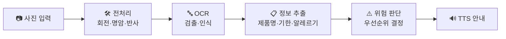

# 🛒 food-package-ocr

> 시각장애인을 위한 식품 패키지 OCR 기반 소비기한·알레르기 음성 안내 시스템

패키지 사진에서 글자를 인식하고, **소비기한 경과 여부**와 **알레르기 성분**처럼 위험한 정보부터 음성으로 안내합니다.

## 🔄 처리 과정



## 👥 팀원 및 역할

| 담당 | 이름 | 역할 | 폴더 | 산출물 |
|---|---|---|---|---|
| AI 1 | 이도현 | 데이터셋 확보·어노테이션, OCR 모델 구축 | `ocr/`, `data/` | OCR 모델, CER/WER |
| AI 2 | 배창현 | 이미지 전처리, 촬영 환경별 OCR 비교 | `preprocessing/` | 전처리 모듈, 환경별 실험 |
| AI 3 | 이서영 | 정보 추출, 날짜 해석, 알레르겐 매칭·위험 판단 | `extraction/` | 정보 추출 모듈, F1 |
| AI 4 | 박세준 | TTS, 웹 데모, 모듈 통합·테스트 | `tts/`, `demo/` | 웹 데모 |
| 보고서·발표 | 박주윤, 백연경, 김세희 | 보고서, 발표 자료, 대본 | `docs/` | 보고서, PPT |

## 📁 폴더 구조

```
food-package-ocr/
├── ocr/             # OCR 실행, CER/WER 평가
├── preprocessing/   # 이미지 전처리
├── extraction/      # 정보 추출, 위험 판단
├── tts/             # 음성 안내
├── demo/            # 웹 데모
├── data/
│   ├── raw/         # 촬영 사진 (깃에는 올리지 않음)
│   └── labels/      # gt.csv, split.csv, 제품 목록표
├── notebooks/       # 코랩 노트북
├── results/         # 실험 결과 표·그래프
└── docs/            # 보고서, 발표 자료
```

## 🔗 모듈 간 데이터 형식

OCR 결과는 줄 단위로 아래 형식으로 전달합니다.

```json
{
  "image": "P004_1.jpg",
  "lines": [
    {"text": "2026.12.15 까지", "box": [x1, y1, x2, y2], "confidence": 0.97}
  ]
}
```

## 📊 평가 지표

| 구분 | 지표 |
|---|---|
| OCR | CER, WER |
| 정보 추출 | Precision, Recall, F1 |
| 위험 판단 | 위험 오분류율 (기한·알레르기 오판) |
| 환경 분석 | 조명, 각도, 흐림, 구겨짐별 성능 비교 |

## 🗂 데이터

- 촬영 사진 원본은 구글 드라이브 `ocr_test/new_data`에 보관합니다.
- 파일 이름은 `P001_1.jpg`처럼 **제품번호_번호** 형식입니다.
- 학습/검증/테스트는 **제품 단위**로 나눕니다 (`data/labels/split.csv`).
- 라벨링 대상: 제품명, 날짜, 알레르기 문구, 주의사항 (영양성분표는 평가 제외)

## ✅ 진행 현황

- [x] 레포 생성
- [x] 제품 사진 촬영 (10종, 약 40장)
- [ ] OCR 정답 라벨 (gt.csv)
- [ ] 제품 단위 분할 (split.csv)
- [ ] 초기 CER/WER 평가
- [ ] 전처리 모듈
- [ ] 정보 추출·위험 판단 모듈
- [ ] TTS·웹 데모
- [ ] 모듈 통합 테스트

## 🤝 협업 규칙

- 자기 폴더만 수정하고, 다른 폴더 수정이 필요하면 담당자에게 요청합니다.
- `main`에 바로 올리지 말고, 자기 브랜치에서 작업한 뒤 Pull Request로 합칩니다.
- 커밋 메시지는 `[AI1] OCR 평가 코드 추가`처럼 담당을 앞에 붙입니다.
